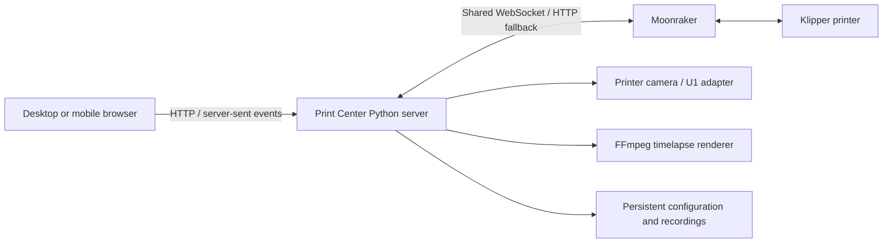

# Print Center

**One dashboard for monitoring and managing multiple 3D printers.**

Print Center is a self-hosted web application built by [Natthabhat Nilsuwan](https://github.com/Natthabhat). It brings camera feeds, print progress, temperatures, printer controls, files, and recordings into one interface, so you can check your print room without opening a separate interface for each machine.

It runs on an Ubuntu server that can reach your printers over the local network. You use it from a desktop or mobile browser.

## What you can do

- **Monitor your print room:** see each printer's connection state, camera, active job, progress, and layers.
- **Control a printer:** change heater targets, home and jog axes, extrude or retract filament, adjust print tuning, and control supported fans and outputs.
- **Manage print jobs:** browse files in grid or detail view, upload sliced files, inspect previews and estimates, and start prints.
- **Choose filament:** configure a supported Qidi multimaterial box and map a print's colors to loaded slots.
- **Review activity:** see printer statistics, print history, and console logs.
- **Record timelapses:** select recording before a print, then play or download the rendered MP4 from the printer files panel.
- **Customize the dashboard:** choose visible temperature sensors and controls, and save timelapse settings separately for each printer.

## Printer support and source status

The code currently published in this repository connects to **Klipper through Moonraker**.

| Printer / connection | Support in this repository |
| --- | --- |
| Qidi Q2 | Moonraker status, camera, controls, files, and supported multimaterial box workflows. |
| Snapmaker U1 | Moonraker controls and files, with a dedicated LAN camera adapter and caselight support. |
| Other Klipper printers | Moonraker integration; available controls depend on the printer's configuration and firmware. |

**The author's running deployment contains newer extensions that have not yet been synchronized into this repository.** These include Bambu Lab X2D LAN integration, local AI plate inspection, remembered login sessions, and newer file-action/material-picker interfaces. Cloning this revision does not install those extensions. The technical instructions below describe the source available here.

Print Center sends commands through the printer's existing services. It does not replace Klipper, Moonraker, slicer software, or printer firmware. Files must already be sliced for the target printer.

## Typical workflow

1. Start Print Center on a server that can reach the printers and cameras.
2. Open **Manage printers** and add a printer's Moonraker address, usually `http://PRINTER_IP:7125`. Add its API key if required.
3. Use the overview to monitor the fleet, then open a printer for detailed controls.
4. Upload a sliced file or choose an existing one. Review materials and the build plate before starting.
5. Optionally enable **Record timelapse**. After the job, find the video in **Printer files → Timelapses**.

## Technical overview

### Architecture

The frontend is plain HTML, CSS, and JavaScript. A Python server handles printer connections, camera requests, file uploads, authentication, and timelapse jobs. No frontend build step or separate database service is required.



- **Live status:** the server shares Moonraker WebSocket subscriptions across browser clients and streams updates using server-sent events (SSE). HTTP polling provides a fallback.
- **Camera handling:** supports Moonraker camera configuration and a Snapmaker U1 adapter, with checks for stale camera frames.
- **Files:** uploads are limited to 200 MB. Embedded slicer metadata supplies previews, filament usage, and duration estimates where available.
- **Timelapses:** FFmpeg captures/renders recordings on the server. Recording does not park or move the toolhead.
- **Persistence:** printer configuration and recordings live in the configured data directory. Browser preferences control selected dashboard views.

### Main modules

| File | Responsibility |
| --- | --- |
| `app.py` | HTTP endpoints, printer registry, Moonraker requests, command handling, and uploads. |
| `app.js` | Dashboard rendering, live updates, charts, controls, and print dialogs. |
| `index.html` | Application markup and styling. |
| `live_status.py` | Shared Moonraker status connections and fallback handling. |
| `camera_monitor.py` | Snapmaker U1 camera integration and freshness checks. |
| `box_control.py` | Qidi box material parsing, configuration, and print-slot mapping. |
| `timelapse.py` | Frame capture, recording state, video rendering, and storage. |
| `web_auth.py` / `login.html` | Website login and revocable sessions for the configured public hostname. |
| `compose.yaml` / `Dockerfile` | Ubuntu Docker deployment, persistent storage, and health checks. |

## Installation

### Docker on Ubuntu

Requirements: Git, Docker Engine with Compose, and network access from the server to Moonraker and the cameras. The supplied Compose file uses **host networking** and is intended for Linux.

```sh
git clone https://github.com/Natthabhat/Print-Center.git
cd Print-Center
mkdir -p data
sudo chown 1000:1000 data
```

Create `.env` with the server address you want to use:

```dotenv
DASHBOARD_BIND=192.168.1.10
DASHBOARD_PORT=8787
```

Replace `192.168.1.10` with an address assigned to your server. Then start the application:

```sh
docker compose build --pull
docker compose up -d
docker compose ps
```

Open `http://192.168.1.10:8787` and add your printers through **Manage printers**. The image includes FFmpeg, runs as UID/GID 1000, and mounts `./data` at `/data`. The application filesystem is read-only, Linux capabilities are dropped, and a health check monitors the web service.

To update or inspect logs:

```sh
git pull --ff-only
docker compose up -d --build
docker compose logs --tail=100 print-center
```

The Compose file builds an image locally; it does not pull a prebuilt Print Center image from a registry.

### Run directly with Python

Use Python 3.10 or later. Install FFmpeg separately if you want timelapse recording.

```sh
python3 -m venv .venv
.venv/bin/pip install -r requirements.txt
PRINTER_HOST=192.168.1.100 DASHBOARD_BIND=127.0.0.1 .venv/bin/python app.py
```

Open `http://127.0.0.1:8787` on the server. `PRINTER_HOST` sets the fallback Moonraker printer before saved configuration is available. Add or edit connections in the interface.

An optional user-service example is provided in `print-center.service`. Adjust its working directory and bind address before installing it under `~/.config/systemd/user/`.

## Configuration and remote access

| Variable | Purpose | Default |
| --- | --- | --- |
| `DASHBOARD_BIND` | Primary server interface to listen on. | `127.0.0.1` |
| `DASHBOARD_EXTRA_BIND` | Optional second server address, such as a LAN address alongside Tailscale. | Empty |
| `DASHBOARD_PORT` | Web interface port. | `8787` |
| `DASHBOARD_DATA_DIR` | Persistent configuration and recording directory. | Project directory; `/data` in Docker |
| `PRINTER_HOST` | Fallback printer host for direct Python startup. | `192.168.1.100` |
| `DASHBOARD_PUBLIC_HOST` | Exact public hostname served through an HTTPS reverse proxy. | Empty |
| `DASHBOARD_AUTH_USER` | Username for public-host login. | Empty |
| `DASHBOARD_AUTH_HASH` | PBKDF2-HMAC-SHA256 password hash in `hex_salt:hex_digest` format, with 200,000 iterations. | Empty |

For private remote access, bind to the server's Tailscale address. To also serve the LAN, set `DASHBOARD_EXTRA_BIND` to its LAN address.

For an HTTPS reverse proxy or tunnel, set the exact public hostname and both authentication variables. The proxy must preserve the public `Host` header. Public-host requests use the website login form and a Secure, HttpOnly, SameSite session cookie. In this repository revision, sessions expire after eight hours and are lost on server restart; sign-out revokes a session. Missing authentication configuration disables access through the configured public hostname.

**Explicit LAN and Tailscale access bypasses that public-host login.** Keep those interfaces on trusted networks. Do not forward the application port directly to the public internet. Store credentials in the ignored `.env` file, rather than in the repository.

## Data and timelapses

- `printers.json` stores printer connections, settings, and optional Moonraker API keys with owner-only permissions. API keys are not returned by the printer registry API.
- Docker keeps persistent data under `./data`; back up this directory when migrating an installation.
- Timelapse files are stored under `data/timelapses` in Docker. Videos are rendered to MP4 at 30 fps.
- Per-printer settings choose **Every 10 seconds** or **Every layer change**. Layer capture requires the sliced job to report layer changes to Klipper; paused jobs do not trigger layer captures.
- Each recording is capped at 512 MB of frames, and capture stops when disk space is low. Successful rendering removes temporary frames.
- Keep the server running during capture and rendering. A restart interrupts active recordings; completed videos remain available.

## Development and validation

Install the Python dependencies, then run:

```sh
python3 -m unittest discover -q
node --check app.js
```

Node.js is only needed for the JavaScript syntax check. Tests use mocks and do not intentionally move, heat, or start a physical printer.

When reporting an issue, include the printer model, firmware/Moonraker version, the action you attempted, the visible error, and relevant sanitized logs. Do not include API keys, access codes, cookies, or `.env` contents.

## Practical limitations

Controls depend on the printer's exposed objects and firmware. Temperature graphs show browser-session history. Filament weights and remaining times may be estimates, and model previews require embedded slicer thumbnails. Verify the printer, selected materials, and build plate before starting a job.

## Author

Built by **[Natthabhat Nilsuwan](https://github.com/Natthabhat)** as part of a self-hosted 3D printing and engineering workflow.

[Engineering portfolio](https://profile.natthabhat.com/) · [GitHub profile](https://github.com/Natthabhat)
