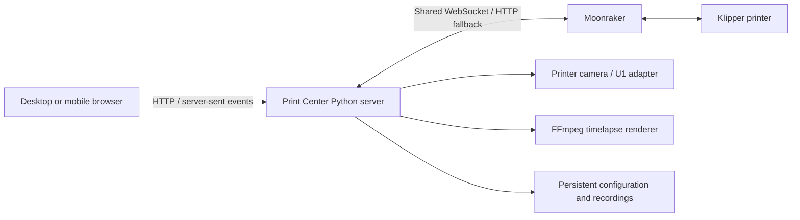

# Print Center

**One dashboard for monitoring and managing multiple 3D printers.**

Print Center is a self-hosted web application built by [Natthabhat Nilsuwan](https://github.com/Natthabhat). It brings camera feeds, print progress, temperatures, printer controls, files, and recordings into one interface, so you can check your print room without opening a separate interface for each machine.

It runs on an Ubuntu server that can reach your printers over the local network. You use it from a desktop or mobile browser.

## What you can do

- **Monitor your print room:** see each printer's connection state, camera, active job, progress, and layers.
- **Control a printer:** change heater targets, home and jog axes, extrude or retract filament, adjust print tuning, and control supported fans and outputs.
- **Manage print jobs:** browse files in grid or detail view, upload sliced files, inspect previews and estimates, and start prints.
- **Choose filament:** configure a supported Qidi multimaterial box and map a print's colors to loaded slots.
- **Review activity:** see printer statistics, print history, and console logs.
- **Record timelapses:** select recording before a print, then play or download the rendered MP4 from the printer files panel.
- **Customize the dashboard:** choose visible temperature sensors and controls, and save timelapse settings separately for each printer.

## Printer support and source status

Print Center connects to **Klipper through Moonraker** and to **Bambu Lab printers over LAN MQTT**.

| Printer / connection | Support in this repository |
| --- | --- |
| Qidi Q2 | Moonraker status, camera, controls, files, and supported multimaterial box workflows. |
| Snapmaker U1 | Moonraker controls and files, with a dedicated LAN camera adapter and caselight support. |
| Bambu Lab X2D | LAN MQTT status and controls, RTSPS camera, FTPS file panel. See [Bambu Lab X2D LAN profile](#bambu-lab-x2d-lan-profile). |
| Other Klipper printers | Moonraker integration; available controls depend on the printer's configuration and firmware. |

Optional extensions include local AI build-plate inspection (advisory only, via a local vision model), a PostgreSQL-backed model library, custom printer photos, and remembered login sessions.

Print Center sends commands through the printer's existing services. It does not replace Klipper, Moonraker, slicer software, or printer firmware. Files must already be sliced for the target printer.

## Bambu Lab X2D LAN profile

Choose **Manage printers → Add printer → Bambu Lab X2D**, enter the printer's private IP and eight-character LAN access code, and save. An optional serial number pins the connection to that printer. Otherwise, the serial is detected from its Bambu-signed TLS certificate before MQTT authentication. The LAN MQTT service must be enabled and reachable on port 8883. No Bambu cloud login is used. Access codes stay in the owner-only server configuration and are never returned by the printer registry API. Leaving the code blank while editing keeps the existing code.

This profile supports live print state, progress, remaining time, layers, reported active/dual-nozzle/bed/chamber temperatures, speed factor, Wi-Fi, error/fault counts, AMS material/color/temperature/humidity information, and a shared 2 fps camera feed. Available controls include pause/resume/cancel, active-nozzle/bed targets, part/auxiliary/chamber fans, chamber light and four speed presets. Each control waits for a matching printer acknowledgment. Firmware may require LAN Developer Mode for third-party commands; Print Center does not change that mode. Commands with no acknowledgment produce an error and are never automatically retried. Active nozzle target is capped at 300°C and bed at 110°C. Hotend fan and per-nozzle temperature readings are read only. No movement, heating or print commands are sent during tests.

Camera frames come from the printer's RTSPS service on port 322. A loopback-only RTSP bridge verifies the Bambu certificate chain and serial before forwarding authentication. FFmpeg receives a local stream, produces bounded JPEG frames, and stops after 25 seconds without viewers. Multiple dashboard viewers share one connection. The access code and private camera URL are never returned to the browser. Camera certificate validation uses the bundled, verified N6-V2 intermediate because the RTSPS service omits it from its chain.

Missing telemetry stays unknown. Bambu toolhead controls provide all/per-axis homing and bounded relative X/Y/Z jogging. Homing requires confirmation. Jogging requires that axis to have been homed through the current Print Center MQTT connection; this resets on reconnect or a new print. Manual movement is blocked during printing, pause, errors or unknown state. X/Y steps are capped at 10 mm and Z at 1 mm. Position telemetry and extrusion/Z-offset calibration are not exposed by this profile.

The printer file panel uses implicit FTPS on port 990 with Bambu certificate and serial verification on control and data connections. It lists printable files in accessible storage, supports 3MF/G-code upload (up to 200 MB, without overwriting existing names), authenticated downloads, embedded 3MF thumbnails/weight/time, grid/detail views, and recoverable trash/restore through printer-side rename. Uploads go to `/cache`; they never start printing. Built-in/internal printer models not exposed by FTPS cannot be listed. Archive reads are bounded and temporary; previews are cached. Only disposable comments-only files are used for live transfer tests and are removed afterward.

Starting Bambu prints, AMS configuration/load/unload, history and timelapse capture are not yet implemented. Those unsupported features remain hidden or rejected for this profile. Existing Qidi, Snapmaker and generic Klipper connections retain their functionality.

`bambu_ca.pem` contains the public Bambu certificate authorities distributed by [OpenBambuAPI](https://github.com/Doridian/OpenBambuAPI/blob/main/examples/ca_cert.pem), plus BBL Device CA N6-V2 obtained from the printer's MQTT certificate chain and verified with `openssl verify` against the existing Bambu roots before inclusion. TLS verifies the certificate chain, expiry and serial common name before sending the access code. Python 3.13+ strict CA extension checking is relaxed for this CA's missing extensions; signature/chain verification stays enabled. The MQTT client uses paho-mqtt 2.1.

Validate with `python -m unittest discover -q` and `node --check app.js`. Hardware verification requires the printer's LAN access code; tests do not move or heat the printer.

Each printer has a **Printer settings** page. Choose timelapse capture **Every 10 seconds** (default) or **Every layer change**, then save. Settings persist on the server separately for each printer and apply to future jobs when **Record timelapse** is checked. Layer capture follows `print_stats.info.current_layer` from Moonraker; the sliced file must report layer changes to Klipper. It captures a camera frame without toolhead parking. Paused jobs do not trigger layer captures. Existing recordings keep the capture mode selected when they started.

## Typical workflow

1. Start Print Center on a server that can reach the printers and cameras.
2. Open **Manage printers** and add a printer's Moonraker address, usually `http://PRINTER_IP:7125`. Add its API key if required.
3. Use the overview to monitor the fleet, then open a printer for detailed controls.
4. Upload a sliced file or choose an existing one. Review materials and the build plate before starting.
5. Optionally enable **Record timelapse**. After the job, find the video in **Printer files → Timelapses**.

## Technical overview

### Architecture

The frontend is plain HTML, CSS, and JavaScript. A Python server handles printer connections, camera requests, file uploads, authentication, and timelapse jobs. No frontend build step is required. PostgreSQL is only needed for the optional model library.



- **Live status:** the server shares Moonraker WebSocket subscriptions across browser clients and streams updates using server-sent events (SSE). HTTP polling provides a fallback.
- **Camera handling:** supports Moonraker camera configuration and a Snapmaker U1 adapter, with checks for stale camera frames.
- **Files:** uploads are limited to 200 MB. Embedded slicer metadata supplies previews, filament usage, and duration estimates where available.
- **Timelapses:** FFmpeg captures/renders recordings on the server. Recording does not park or move the toolhead.
- **Persistence:** printer configuration and recordings live in the configured data directory. Browser preferences control selected dashboard views.

### Main modules

| File | Responsibility |
| --- | --- |
| `app.py` | HTTP endpoints, printer registry, Moonraker requests, command handling, and uploads. |
| `app.js` | Dashboard rendering, live updates, charts, controls, and print dialogs. |
| `index.html` | Application markup and styling. |
| `live_status.py` | Shared Moonraker status connections and fallback handling. |
| `camera_monitor.py` | Snapmaker U1 camera integration and freshness checks. |
| `box_control.py` | Qidi box material parsing, configuration, and print-slot mapping. |
| `timelapse.py` | Frame capture, recording state, video rendering, and storage. |
| `bambu.py` / `bambu_camera.py` / `bambu_files.py` | Bambu LAN MQTT, RTSPS camera bridge and FTPS file access. |
| `plate_detection.py` | Local, advisory build-plate inspection. Model output never executes printer commands. |
| `model_library.py` / `library.js` | PostgreSQL-backed model library with files in persistent storage. |
| `printer_photos.py` | Validated custom printer photos. |
| `frame_cache.py` | One shared, bounded camera snapshot producer per printer. |
| `completion_status.py` | Persists the post-print completion display period. |
| `web_auth.py` / `login.html` | Website login and revocable sessions for the configured public hostname. |
| `compose.yaml` / `Dockerfile` | Ubuntu Docker deployment, persistent storage, and health checks. |

## Installation

### Docker on Ubuntu

Requirements: Git, Docker Engine with Compose, and network access from the server to Moonraker and the cameras. The supplied Compose file uses **host networking** and is intended for Linux.

```sh
git clone https://github.com/Natthabhat/Print-Center.git
cd Print-Center
mkdir -p data
sudo chown 1000:1000 data
```

Create `.env` with the server address you want to use:

```dotenv
DASHBOARD_BIND=192.168.1.10
DASHBOARD_PORT=8787
```

Replace `192.168.1.10` with an address assigned to your server. Then start the application:

```sh
docker compose build --pull
docker compose up -d
docker compose ps
```

Open `http://192.168.1.10:8787` and add your printers through **Manage printers**. The image includes FFmpeg, runs as UID/GID 1000, and mounts `./data` at `/data`. The application filesystem is read-only, Linux capabilities are dropped, and a health check monitors the web service.

To update or inspect logs:

```sh
git pull --ff-only
docker compose up -d --build
docker compose logs --tail=100 print-center
```

The Compose file builds an image locally; it does not pull a prebuilt Print Center image from a registry.

### Run directly with Python

Use Python 3.10 or later. Install FFmpeg separately if you want timelapse recording.

```sh
python3 -m venv .venv
.venv/bin/pip install -r requirements.txt
PRINTER_HOST=192.168.1.100 DASHBOARD_BIND=127.0.0.1 .venv/bin/python app.py
```

Open `http://127.0.0.1:8787` on the server. `PRINTER_HOST` sets the fallback Moonraker printer before saved configuration is available. Add or edit connections in the interface.

An optional user-service example is provided in `print-center.service`. Adjust its working directory and bind address before installing it under `~/.config/systemd/user/`.

## Configuration and remote access

| Variable | Purpose | Default |
| --- | --- | --- |
| `DASHBOARD_BIND` | Primary server interface to listen on. | `127.0.0.1` |
| `DASHBOARD_EXTRA_BIND` | Optional second server address, such as a LAN address alongside Tailscale. | Empty |
| `DASHBOARD_PORT` | Web interface port. | `8787` |
| `DASHBOARD_DATA_DIR` | Persistent configuration and recording directory. | Project directory; `/data` in Docker |
| `PRINTER_HOST` | Fallback printer host for direct Python startup. | `192.168.1.100` |
| `DASHBOARD_PUBLIC_HOST` | Exact public hostname served through an HTTPS reverse proxy. | Empty |
| `DASHBOARD_AUTH_USER` | Username for public-host login. | Empty |
| `PRINT_CENTER_DATABASE_URL` | Optional PostgreSQL connection string for the model library. | Empty |
| `DASHBOARD_AUTH_HASH` | PBKDF2-HMAC-SHA256 password hash in `hex_salt:hex_digest` format, with 200,000 iterations. | Empty |

For private remote access, bind to the server's Tailscale address. To also serve the LAN, set `DASHBOARD_EXTRA_BIND` to its LAN address.

For an HTTPS reverse proxy or tunnel, set the exact public hostname and both authentication variables. The proxy must preserve the public `Host` header. Public-host requests use the website login form and a Secure, HttpOnly, SameSite session cookie. Sessions expire after eight hours, or after 30 days when **Remember me** is checked; remembered sessions survive server restarts. Sign-out revokes a session. Missing authentication configuration disables access through the configured public hostname.

**Explicit LAN and Tailscale access bypasses that public-host login.** Keep those interfaces on trusted networks. Do not forward the application port directly to the public internet. Store credentials in the ignored `.env` file, rather than in the repository.

## Data and timelapses

- `printers.json` stores printer connections, settings, and optional Moonraker API keys with owner-only permissions. API keys are not returned by the printer registry API.
- Docker keeps persistent data under `./data`; back up this directory when migrating an installation.
- Timelapse files are stored under `data/timelapses` in Docker. Videos are rendered to MP4 at 30 fps.
- Per-printer settings choose **Every 10 seconds** or **Every layer change**. Layer capture requires the sliced job to report layer changes to Klipper; paused jobs do not trigger layer captures.
- Each recording is capped at 512 MB of frames, and capture stops when disk space is low. Successful rendering removes temporary frames.
- Keep the server running during capture and rendering. A restart interrupts active recordings; completed videos remain available.

## Development and validation

Install the Python dependencies, then run:

```sh
python3 -m unittest discover -q
node --check app.js
```

Node.js is only needed for the JavaScript syntax check. Tests use mocks and do not intentionally move, heat, or start a physical printer.

When reporting an issue, include the printer model, firmware/Moonraker version, the action you attempted, the visible error, and relevant sanitized logs. Do not include API keys, Bambu access codes, cookies, or `.env` contents.

## Practical limitations

Controls depend on the printer's exposed objects and firmware. Temperature graphs show browser-session history. Filament weights and remaining times may be estimates, and model previews require embedded slicer thumbnails. Verify the printer, selected materials, and build plate before starting a job.

## Author

Built by **[Natthabhat Nilsuwan](https://github.com/Natthabhat)** as part of a self-hosted 3D printing and engineering workflow.

[Engineering portfolio](https://profile.natthabhat.com/) · [GitHub profile](https://github.com/Natthabhat)
